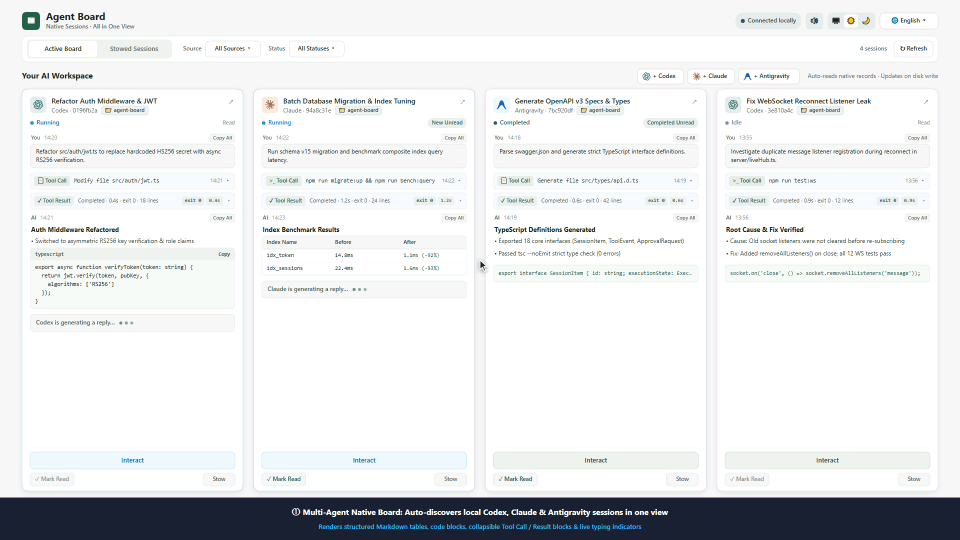

# Agent Board

<p align="center">
  <strong>Local Multi-Agent Grid Dashboard · Native Sessions · All in One View</strong>
</p>

<p align="center">
  <strong>English</strong> | <a href="README_zh.md">简体中文</a> | <a href="README_zh-TW.md">繁體中文</a> | <a href="README_ja.md">日本語</a>
</p>

<p align="center">
  
  
  
  
  
</p>

<p align="center">
  <a href="https://useless-lab-ai.github.io/agent-board/promo-video/index.html?lang=en-US" title="Click to launch interactive 60 FPS promo video showcase">
    
  </a>
  <br />
  <em>🎬 <b>Interactive 60 FPS Showcase Video</b>: Animated showcase playing above; click the video or open the <a href="https://useless-lab-ai.github.io/agent-board/promo-video/index.html?lang=en-US"><b>Live 60 FPS Interactive Player</b></a> (local: <a href="promo-video/index.html?lang=en-US"><code>promo-video/index.html</code></a>) to experience live terminal streaming, in-place approvals, and procedural audio (Supports EN / 简 / 繁 / 日本語).</em>
</p>

**Agent Board** is a lightweight, non-invasive local dashboard for developers orchestrating multiple AI coding agents. Purpose-built for **Codex**, **Claude Code**, and **Antigravity**, it automatically discovers your local sessions, tracks streaming outputs across a stable grid view, and enables live two-way interaction and approvals in interactive modals—all without taking over or terminating your original terminal or IDE instances.

---

## 🌟 Key Features

- 🔍 **Zero-Config Auto Discovery**: Out of the box, Agent Board scans `%USERPROFILE%\.codex\sessions`, `.claude\projects`, and Antigravity native logs. No manual imports or configuration needed.
- ⚡ **Real-Time Stream Tracking**: Directly reads and tails native JSONL logs without duplicating chats into a third-party database. Features full Markdown rendering and collapsible tool-call inspection.
- 🎮 **Live Two-Way Interaction**:
  - **OpenAI Codex**: Automatically connects to running local IPC sessions in VS Code / Desktop. Send instructions, approve commands/file edits, answer structured questions, or interrupt turns.
  - **Anthropic Claude Code**: Powered by a zero-touch VS Code transparent `stdin/stdout` bridge (`agent-board-bridge`) and MCP Channels fallback (`claude-board`). Send human-authorized turns, review Unified Diffs for file edits, approve/deny commands, and answer interactive questions (`AskUserQuestion`) with bidirectional VS Code card sync.
  - **Antigravity**: Native workspace discovery and live turn dispatch via `language_server.exe`.
- ➕ **One-Click Session Creation & Multimodal Attachments**: Launch new Codex, Claude Code, or Antigravity sessions directly from the board (with workspace, model, and permission selection), and paste or upload image/file attachments in the interaction modal.
- 🛡️ **Privacy & Security by Design**:
  - Binds strictly to loopback (`127.0.0.1`), protected by exact Host/Origin checks to block CSRF and LAN eavesdropping;
  - Never bypasses security prompts or grants autonomous tool permissions;
  - Local SQLite database only stores display metadata (cursors, card ordering, archive status)—never raw chat transcripts.
- 🌐 **Full Internationalization (i18n)**: Seamlessly toggle between Simplified Chinese (`zh-CN`), Traditional Chinese (`zh-TW`), English (`en-US`), and Japanese (`ja-JP`), with instant persistence.
- 📱 **Clean & Responsive Grid Layout**: Stable auto-wrapping cards with independent scroll zones, status filters, read-tracking, and board archiving.

---

## 🚀 Quick Start

### Prerequisites
- **Node.js** >= 22.13.0

### Installation & Launch

```powershell
# 1. Clone repository
git clone https://github.com/Useless-Lab-AI/agent-board.git
cd agent-board

# 2. Install dependencies & build
npm install
npm run build

# 3. Start local service
npm start
```

Open your browser at **http://127.0.0.1:4317**.

> [!NOTE]
> For security reasons, the server only listens on loopback (`127.0.0.1`). Avoid accessing via LAN IPs. For active backend development, use `npm run dev`.

---

## 🖥️ Desktop Client (Electron)

Agent Board can run as a full-featured, cross-platform native desktop application with zero configuration needed.

### Running Desktop Mode
```powershell
# Build and run the desktop app
npm run desktop

# Or if already built:
npm run desktop:start
```

### Packaging & Distribution
Multi-platform packaging is powered by `electron-builder`:

```powershell
# Windows: Generate NSIS Setup installer (.exe)
npm run dist:win

# Windows: Fast portable unpacked directory
npm run pack:dir

# macOS: Generate .dmg and .zip (Intel x64 & Apple Silicon arm64)
npm run dist:mac

# Linux: Generate .AppImage and .deb
npm run dist:linux

# All platforms (from supported host or CI)
npm run dist:all
```
Generated installers and binaries are placed in `dist-desktop/`.

### Native Desktop Features
- 🚀 **Embedded Background Server**: Electron manages the backend Node.js service as an isolated `utilityProcess`—no terminal window required, clean startup and shutdown.
- 🔔 **System Notifications for Approvals**: Automatically sends native OS desktop notifications when any agent needs approval or input (`WAITING_APPROVAL` / `WAITING_INPUT`), with click-to-focus.
- 📌 **System Tray Integration**: Minimize to tray, view server status, open web companion, restart server, or quit cleanly.
- 📐 **Persistent Window State**: Remembers window dimensions, position, and maximized state across sessions.
- 🌐 **Cross-Platform IPC**: Seamlessly connects to OpenAI Codex named pipes on Windows (`\\.\pipe\codex-ipc`) and Unix domain sockets on macOS/Linux (`/tmp/codex-ipc`).

---

## 🔌 Connecting Agents for Live Interaction

Agent Board provides **automatic read-only monitoring out of the box** for all discovered sessions. To enable interactive prompts and approvals from the web UI:

### 1. OpenAI Codex
- **Zero Config**: Simply open your session in VS Code or Codex Desktop. The modal automatically detects the active local IPC socket and establishes a follower connection.
- Supports messaging, command/file approvals, multiple-choice questions, and turn interruption.

### 2. Anthropic Claude Code
In Claude Code, external Named Pipes are strictly treated as untrusted subagent peer channels (`kind: "peer"`), which triggers prompt-injection warning banners and suppresses messages from rendering as user bubbles in VS Code. The **only** way to send genuine human-authorized turns is through standard input (`stdin`).

To make this **100% transparent and zero-touch**, Agent Board includes a native Go process wrapper bridge ([`bridge/main.go`](bridge/main.go)) that multiplexes `stdin`/`stdout` between VS Code and Agent Board.

#### Option A (Recommended): Transparent VS Code Stdin Bridge (Zero Daily Commands)
- **Desktop Client (Automatic)**: The compiled `agent-board-bridge.exe` is packaged directly inside the Electron desktop application (`resources/bin/agent-board-bridge.exe`). On startup (or via Tray Menu → **Setup Claude Bridge**), Agent Board automatically installs the bridge to `~/.claude/agent-board-bridge.exe` and configures VS Code.
- **CLI One-Click Setup**:
  ```powershell
  # Compiles bridge/main.go (requires Go) and auto-configures VS Code settings.json
  npm run setup:bridge
  ```
- **Manual VS Code Configuration**:
  Add the following to your VS Code User `settings.json` (`%APPDATA%\Code\User\settings.json`):
  ```json
  "claudeCode.claudeProcessWrapper": "C:\\Users\\<YourUsername>\\.claude\\agent-board-bridge.exe"
  ```
- **Daily Usage & Capabilities**: Simply open and use Claude Code in VS Code as normal! No terminal flags or special startup commands needed:
  - Messages sent from Agent Board appear directly in the VS Code chat UI with full human user authority;
  - Tool permission prompts (`Edit`, `MultiEdit`, `Write`, `Bash`) and interactive questions (`AskUserQuestion`) are intercepted in real time, displaying syntax-highlighted Unified Diffs and interactive approval/question cards on Agent Board;
  - Approving or denying in Agent Board automatically dismisses the permission card in VS Code (and vice versa) while preventing duplicate responses.

#### Option B: Terminal MCP Channel Setup (`claude-board`)
For standalone terminal sessions outside VS Code, you can also use the MCP Channels workflow:
```powershell
npm run setup
claude-board
```

### 3. Google Antigravity
- **Zero Config**: Automatically discovers local Antigravity conversations (`~/.gemini/antigravity/brain`) and communicates via the official `language_server.exe agentapi send-message` interface with full user authority.

---

## 📐 Architecture & Principles

| Dimension | Principles |
| :--- | :--- |
| **Source of Truth** | Native session logs are the sole source of truth. Agent Board never alters, replaces, or fakes native history. |
| **Client Lifecycle** | The original client remains open and active—no handoff required. Closing or restarting Agent Board never kills original agent processes. |
| **State Separation** | Execution state (Running, Waiting, Completed) is strictly decoupled from reading state (Read, Unread, Archived). |
| **Data Boundary** | SQLite resides at `%LOCALAPPDATA%\AgentBoard\board.sqlite`, storing only read cursors and presentation preferences—no chat copies or tokens. |

---

## ⚙️ Environment Variables

Customize server parameters at startup:

| Variable | Default | Description |
| :--- | :--- | :--- |
| `AGENT_BOARD_PORT` | `4317` | Local loopback listening port |
| `AGENT_BOARD_CODEX_HOME` | `%USERPROFILE%\.codex` | Codex session and config root |
| `AGENT_BOARD_CLAUDE_HOME` | `%USERPROFILE%\.claude` | Claude session and config root |
| `AGENT_BOARD_ANTIGRAVITY_HOME` | `%USERPROFILE%\.gemini\antigravity` | Antigravity session root |
| `AGENT_BOARD_DATA` | `%LOCALAPPDATA%\AgentBoard` | Agent Board SQLite storage path |

---

## 🧪 Verification & Quality Assurance

Agent Board follows rigorous integration and contract verification using synthetic sandboxes and real protocol endpoints:

```powershell
# Typecheck
npm run typecheck

# Production build
npm run build

# i18n dictionary structural alignment & browser check
npm run verify:i18n

# Claude Code transparent bridge approval, diff & question verification
npm run verify:claude-approval

# Multimodal attachment upload & lifecycle verification
npm run verify:attachments

# Local IPC & MCP protocol interaction verification
node scripts/verify-live-interaction.mjs

# HTTP security, lifecycle & SSE stream verification
npm run verify:http
```

---

## 📄 License

This project is licensed under the [MIT License](LICENSE).
