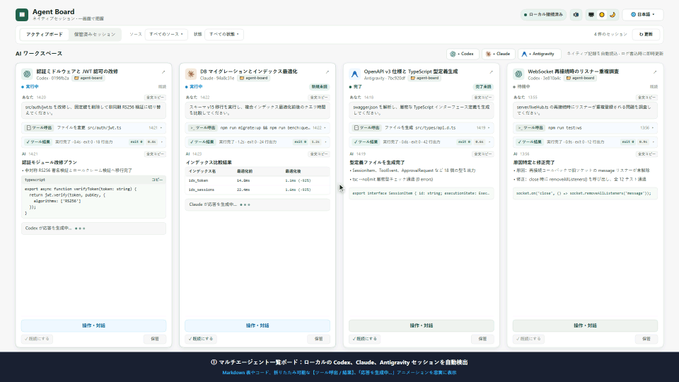
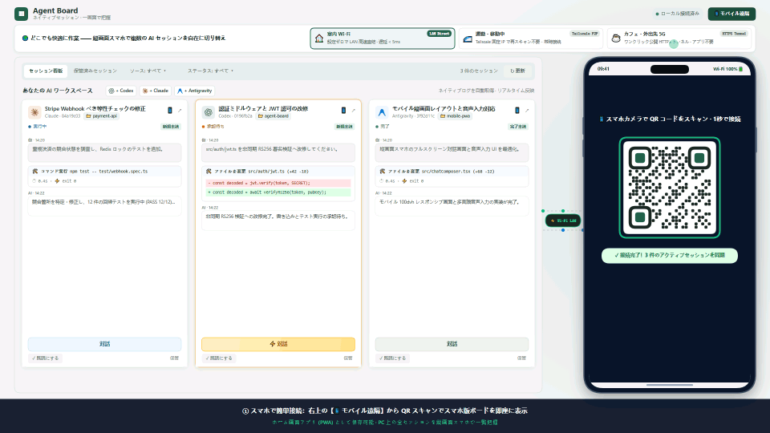

# Agent Board

<p align="center">
  <strong>ローカルマルチエージェントセッショングリッドダッシュボード · ネイティブセッションを一元管理</strong>
</p>

<p align="center">
  <a href="README.md">English</a> | <a href="README_zh.md">简体中文</a> | <a href="README_zh-TW.md">繁體中文</a> | <strong>日本語</strong>
</p>

<p align="center">
  
  
  
  
  
</p>

<p align="center">
  <a href="https://useless-lab-ai.github.io/agent-board/promo-video/index.html?lang=ja-JP" title="クリックして 60 FPS インタラクティブ実演プレーヤーを起動">
    
  </a>
  <br />
  <em>🎬 <b>インタラクティブ 60 FPS 実演動画</b>：画面をクリックするか、<a href="https://useless-lab-ai.github.io/agent-board/promo-video/index.html?lang=ja-JP"><b>🖥️ デスクトップ版 60 FPS 実演プレーヤー</b></a>（ローカル：<a href="promo-video/index.html?lang=ja-JP"><code>promo-video/index.html</code></a>）| <a href="https://useless-lab-ai.github.io/agent-board/promo-video/mobile.html?lang=ja-JP"><b>📱 スマホ接続・どこでも作業・音声入力プレーヤー</b></a>（ローカル：<a href="promo-video/mobile.html?lang=ja-JP"><code>promo-video/mobile.html</code></a>）を開いて体験できます。</em>
</p>

**Agent Board** は、ローカル環境で複数の AI コーディングエージェントを並行して運用する開発者のための、軽量かつ非侵入型なダッシュボードです。**Codex**、**Claude Code**、**Antigravity** を完全にサポートし、オリジナルのターミナルや IDE インスタンスを停止・乗っ取ることなく、マシン内の全セッションを自動検出。安定したグリッドビューで進行状況をリアルタイムに追跡し、対話モーダルから双方向の入力や承認を行えます。

---

## 🌟 主な機能

- 🔍 **ゼロコンフィグ自動検出**：起動するだけで `%USERPROFILE%\.codex\sessions`、`.claude\projects`、Antigravity のネイティブログを自動スキャン。手動インポートは不要です。
- ⚡ **リアルタイムストリーム追跡**：ネイティブ JSONL ログを直接追跡。第三者データベースへの二重保存やセッション複製を行わず、Markdown 描画やツール実行ログの折りたたみ表示に対応。
- 🎮 **ネイティブ双方向対話制御**：
  - **OpenAI Codex**：VS Code やデスクトップ版で実行中のローカル IPC に自動接続。テキスト送信、コマンド／ファイル承認、選択肢への回答、ターンの割り込み中断をサポート。
  - **Anthropic Claude Code**：ゼロタッチの VS Code 透過 `stdin/stdout` ブリッジ（`agent-board-bridge`）およびスタンドアロン MCP Channels モード（`claude-board`）を搭載。人間ユーザーの権限での指示送信、ファイル編集の Unified Diff 差分プレビュー＆承認、コマンド実行許可、対話型質問への回答（`AskUserQuestion`）、および VS Code 側の承認カードとの双方向リアルタイム同期を実現。
  - **Antigravity**：ネイティブワークスペースの検出と `language_server.exe` による直接ターン送信に対応。
- ➕ **ワンクリック新規セッション作成＆マルチモーダル添付**：ボード上から Codex、Claude Code、Antigravity の新規セッションを直接起動（ワークスペース・モデル・権限選択対応）でき、対話モーダルへの画像やファイルの貼り付け・アップロードにも対応。
- 📲 **スマホ QR リモート操作・音声入力 & ホーム画面アプリ (PWA)**：上部ツールバーおよび各セッションカードに **QR コードリモート接続**を内蔵。**LAN / Tailscale 直接接続**、**ワンクリック公開 HTTPS トンネル**、**カスタムドメイン**の 3 モードに対応し、スマホから外出先でのチャット送信、**多言語リアルタイム音声入力（🎙️ ハンズフリー音声テキスト変換）**、コマンド／Diff 承認、**ホーム画面への独立アプリ（PWA）登録**が可能です。
- 🛡️ **プライバシーとセキュリティ**：
  - ローカルループバック（`127.0.0.1`）はパスワード不要で直接接続でき、外部ネットワークからの通信には **256-bit ランダムトークン + `HttpOnly` Cookie 認証**および厳格な Host / Origin 検証を強制（ワンクリックで全リモート端末を即時遮断可能）；
  - 権限の無断昇格やツールの自動承認は行わず、重要な操作には常にユーザー確認を要求；
  - ローカル SQLite は既読位置や並び順などの表示用メタデータのみを保存し、会話本文やトークンは保持しません。
- 🌐 **多言語対応（i18n）**：日本語（`ja-JP`）、英語（`en-US`）、簡体字中国語（`zh-CN`）、繁体字中国語（`zh-TW`）のスムーズな切り替えをサポート。
- 📱 **快適なグリッドレイアウト**：カードごとに独立したスクロール領域、ステータス絞り込み、既読管理、ダッシュボードアーカイブ機能を搭載。

---

## 🚀 クイックスタート

### 動作環境
- **Node.js** >= 22.13.0

### インストールと起動

```powershell
# 1. リポジトリのクローン
git clone https://github.com/Useless-Lab-AI/agent-board.git
cd agent-board

# 2. 依存関係のインストールとビルド
npm install
npm run build

# 3. ダッシュボードの起動
npm start
```

PC ブラウザで **http://127.0.0.1:4317** を開きます。

> [!NOTE]
> ホスト PC 上では `http://127.0.0.1:4317` でそのままアクセスできます。スマートフォンや別端末からリモート接続する場合は、画面右上の **「📱 スマホ接続」** ボタンから認証用 QR コードをスキャンしてください（未認証の LAN アクセスはセキュリティガードにより遮断されます）。開発時は `npm run dev` でバックエンドを監視できます。

---

## 📱 スマホリモート操作 & ホーム画面アプリ (PWA)

<p align="center">
  <a href="https://useless-lab-ai.github.io/agent-board/promo-video/mobile.html?lang=ja-JP" title="クリックして 60 FPS スマホ遠隔接続・どこでも作業・音声入力インタラクティブプレーヤーを起動">
    
  </a>
  <br />
  <em>📱 <b>QR で即接続 · 縦画面で複数セッション切替 · どこでも作業 · 🎙️ 多言語リアルタイム音声入力</b>：上のアニメーションをクリックするか <a href="https://useless-lab-ai.github.io/agent-board/promo-video/mobile.html?lang=ja-JP"><b>60 FPS モバイル＆音声実演プレーヤー</b></a>（ローカル：<a href="promo-video/mobile.html?lang=ja-JP"><code>promo-video/mobile.html</code></a> · 1080p 動画：<a href="docs/promo-mobile-ja.webm"><code>docs/promo-mobile-ja.webm</code></a>）を開くと、QR ペアリング、縦画面での複数セッション切り替え、Wi-Fi / Tailscale / 5G 越境アクセス、リアルタイム音声入力、スマホ承認の双方向同期を体験できます。</em>
</p>

画面右上の **「📱 スマホ接続」** ボタン（または各セッションカード右上の `📱` アイコン）をクリックすると、モバイルリモート接続モーダルが開きます。Agent Board は室内・外出先を問わず使える **3 つの接続モード**を備えています：

| 接続モード | 最適な用途 | ネットワーク要件 | アドレスの永続性 | おすすめ度 |
| :--- | :--- | :--- | :--- | :--- |
| **1. LAN / Tailscale 直接接続** | 同一 Wi-Fi、または **Tailscale 導入済みの全ネットワーク環境** | 同一 Wi-Fi、または PC・スマホ双方に **Tailscale** | **永続固定**（Tailscale 利用時） | ⭐⭐⭐⭐⭐ **（最もおすすめ）** |
| **2. 公開 HTTPS トンネル** | アプリ未導入での外出先 4G/5G モバイル通信からの一時接続 | PC がインターネット接続可能（スマホ側設定ゼロ） | 起動ごとに一時ドメインを発行 | ⭐⭐⭐⭐ |
| **3. カスタムドメイン / リバースプロキシ** | 自前 FRP、Cloudflare Zero Trust、Tailscale MagicDNS | 独自の外部 URL / リバースプロキシ | 永続固定 | ⭐⭐⭐ |

### 🌟 ベストプラクティス：Tailscale + PWA を強く推奨する理由
1. **モード 1：LAN / Tailscale 直接接続（最推奨）**
   - **同一 Wi-Fi ゼロ設定**：スマホと PC が同じ Wi-Fi に接続されていれば、QR コードを読み取るだけで遅延 `< 5ms` の高速操作が可能です。
   - **Tailscale で屋内外シームレス接続（強く推奨）**：無料の [Tailscale](https://tailscale.com/) を PC とスマホにインストールして同じアカウントでログインすると、Agent Board が `100.64.0.0/10` 帯の **Tailscale 仮想インターフェース**を自動検出し、選択リストに `· Tailscale` と表示します。
   - **固定 IP で再スキャン不要**：Tailscale は PC に**永続固定の `100.x.x.x` IP** を割り当て、WireGuard による暗号化 P2P 通信を行います。自宅の Wi-Fi でも外出先の 5G 回線でも、**QR コードの再スキャンやトンネルの再起動なしでそのままスマホアプリから操作できます**。
2. **モード 2：公開 HTTPS トンネル（インストール不要の一時外出接続）**
   - Tailscale 未導入の環境で外出先の 5G 回線から接続したい場合、モーダル内の **「公開 HTTPS トンネル」** をオンにすると、ローカルの `cloudflared`（Cloudflare TryCloudflare）または標準 `ssh`（`localhost.run`）を自動起動し、数秒で暗号化された `https://xxx` URL と QR コードを生成します。
3. **モード 3：カスタムドメイン / リバースプロキシ**
   - Tailscale MagicDNS（`https://my-pc.tailxxxx.ts.net` など）や独自のリバースプロキシ URL を入力すると、認証トークン付きの QR コードを生成します。

### 📲 縦画面での複数セッション切替・音声入力 & ホーム画面アプリ（PWA）
- **縦画面の複数セッション一覧＆自在な切り替え**：スマホの縦画面（ポートレート表示）に最適化されており、PC 上の全アクティブセッションを一覧表示。カードの **「対話」** をタップすると `100dvh` フルスクリーン対話画面が開き、左上の **`← 一覧へ戻る`** からいつでもボードへ戻って別の Codex / Claude / Antigravity セッションへ切り替えられます。
- **🎙️ 多言語リアルタイム音声入力**：入力欄に **「🎙️ 音声入力」** ボタンを内蔵し、日本語・英語・中国語のリアルタイム音声テキスト変換（Speech-to-Text）に対応。移動中や片手操作でも声だけで素早く指示を送れます。
- **個別セッションのワンタップ引き継ぎ**：各セッションカード右上の `📱` アイコンを押すと、そのセッション専用のディープリンク（`?session=<id>`）付き QR コードが表示されます。スマホで読み取ると**該当セッションの対話・承認画面が直接フルスクリーンで開きます**。
- **スマホのホーム画面にアプリとして追加（PWA）**：
  - **iOS (Safari)**：QR コードからページを開き、下部の **「共有」** ボタン $\rightarrow$ **「ホーム画面に追加」** を選択。
  - **Android (Chrome / Edge)**：QR コードからページを開き、右上メニュー $\rightarrow$ **「アプリをインストール」** または **「ホーム画面に追加」** を選択。
  - 動的に生成される `/manifest.webmanifest` の `start_url` に専用トークンが組み込まれるため、ホーム画面アイコンから起動すると**ブラウザのアドレスバーがない独立したネイティブアプリ風画面**で、再ログイン不要で利用できます。
- **ワンクリック・トークン再生成**：トンネルの起動やトークンのリセットはホスト PC からのみ実行可能です。**「トークン再生成」** を押すと、過去の QR コードや接続済みモバイル端末を即座に無効化できます。

---

## 🖥️ デスクトップクライアント (Electron)

Agent Board は、ゼロコンフィグですぐに使えるネイティブのクロスプラットフォーム・デスクトップアプリケーションとしても動作します。

### デスクトップ版の起動
```powershell
# ビルドしてデスクトップ版を起動
npm run desktop

# ビルド済みの場合に直接起動：
npm run desktop:start
```

### マルチプラットフォームのパッケージングと配布
`electron-builder` により各 OS 向けのインストーラーを生成できます：

```powershell
# Windows：NSIS セットアップインストーラー (.exe) の生成
npm run dist:win

# Windows：ポータブル展開ディレクトリの生成
npm run pack:dir

# macOS：.dmg および .zip の生成 (Apple Silicon arm64 & Intel x64)
npm run dist:mac

# Linux：.AppImage および .deb の生成
npm run dist:linux

# 全プラットフォーム一括ビルド
npm run dist:all
```
生成されたインストーラーや実行ファイルは `dist-desktop/` に出力されます。

### デスクトップ版専用機能
- 🚀 **内蔵バックグラウンドサーバー**：Electron の `utilityProcess` により Node.js バックエンドを分離管理。コンソールウィンドウを表示せず、アプリの起動・終了と完全に連動します。
- 🔔 **承認待ちシステム通知**：いずれかのエージェントが承認待ち・入力待ち（`WAITING_APPROVAL` / `WAITING_INPUT`）になると OS ネイティブ通知を自動表示し、クリックで該当カードへ即座にフォーカスします。
- 📌 **システムトレイ常駐**：トレイへの最小化、サーバーステータス確認、標準ブラウザでの表示、サーバー再起動、安全な終了に対応。
- 📐 **ウィンドウ状態の自動保存**：前回のウィンドウサイズ、表示位置、最大化状態を自動的に記憶・復元。
- 🌐 **クロスプラットフォーム IPC 対応**：Windows の名前付きパイプ（`\\.\pipe\codex-ipc`）および macOS/Linux の Unix ドメインソケット（`/tmp/codex-ipc`）にシームレスに接続。

---

## 🔌 エージェントセッションの接続と対話

すべての検出済みセッションに対して、**初期状態でゼロコンフィグのリアルタイム監視（読み取り専用）**が有効です。Web 画面からメッセージ送信や承認を行う場合は、以下のように連携します：

### 1. OpenAI Codex
- **完全設定不要**：VS Code または Codex デスクトップで該当セッションを開くと、ダッシュボードの対話モーダルがアクティブなローカル IPC を自動認識して接続します。
- テキスト指示の送信、コマンド／ファイル書き込みの承認・拒否、選択肢回答、実行中ターンの停止に対応。

### 2. Anthropic Claude Code
Claude Code の仕様では、外部の名前付きパイプ（Named Pipe）は信頼されないサブエージェント通信（`kind: "peer"`）として扱われるため、プロンプトインジェクション警告が強制挿入され、VS Code のチャット画面には通常のユーザー吹き出しとして表示されません。**完全な人間ユーザーの権限を持ち、VS Code 上で正常にチャット表示される唯一の経路は標準入力（`stdin`）です。**

そのため、Agent Board には Go 標準ライブラリのみで実装された透過的な標準入出力マルチプレクサ・ブリッジ（ソースコード：[`bridge/main.go`](bridge/main.go)）が組み込まれており、**特別な起動コマンド不要で完全にシームレスな双方向対話とインプレース承認**を実現しています：

#### 方法 A（推奨）：VS Code 透過標準入力ブリッジ（普段のコマンド操作ゼロ）
- **デスクトップ版（自動内蔵）**：コンパイル済みの `agent-board-bridge.exe` が Electron デスクトップ版のパッケージ内（`resources/bin/agent-board-bridge.exe`）に直接同梱されています。起動時（またはシステムトレイメニュー → **Setup Claude Bridge**）に、`~/.claude/agent-board-bridge.exe` への配置と VS Code 設定が自動で行われます。
- **CLI ワンクリックビルド＆設定**：
  ```powershell
  # bridge/main.go を自動コンパイル（要 Go 環境）し、VS Code の settings.json を自動設定
  npm run setup:bridge
  ```
- **VS Code の手動設定**：
  VS Code のユーザー設定 `%APPDATA%\Code\User\settings.json` に以下を追加します：
  ```json
  "claudeCode.claudeProcessWrapper": "C:\\Users\\<ユーザー名>\\.claude\\agent-board-bridge.exe"
  ```
- **普段の使い方と対応機能**：いつも通り VS Code で Claude Code パネルを開くだけです！**ターミナルでの特別なコマンドやフラグは一切不要です**：
  - Agent Board から送信したメッセージは Claude の標準入力に直接注入され、VS Code のチャット画面にリアルタイム表示され、完全な人間ユーザーの権限で実行されます；
  - ツール実行の権限確認リクエスト（`Edit` / `MultiEdit` / `Write` ファイル編集、`Bash` コマンド実行）や対話型質問（`AskUserQuestion`）をリアルタイムに検知し、シンタックスハイライト付きの Unified Diff 差分表示や承認・回答カードを Agent Board 上に表示します；
  - Agent Board 側で【許可 / 拒否】すると VS Code 側の承認カードも自動的に閉じられ（重複応答も自動抑止）、逆に VS Code 側で承認した場合も Agent Board の待機状態が即座にクリアされます。

#### 方法 B：スタンドアロン・ターミナル MCP Channel モード（`claude-board`）
VS Code 以外の純粋なターミナル環境で使用する場合は、公式 MCP Channels ウィザードによる連携も利用可能です：
```powershell
npm run setup
claude-board
```

### 3. Google Antigravity
- **完全設定不要**：ローカルの `~/.gemini/antigravity/brain` セッションを自動検出し、公式の `language_server.exe agentapi send-message` インターフェースを通じて完全なユーザー権限で直接メッセージを送信します。

---

## 📐 アーキテクチャと設計思想

| 観点 | 設計方針と原則 |
| :--- | :--- |
| **信頼できる唯一の情報源** | ネイティブのセッションログが唯一の真実です。ダッシュボードが元ファイルを変更・偽装することはありません。 |
| **クライアントのライフサイクル** | オリジナルのターミナル／IDE は常に開いたまま動作します。ダッシュボードを再起動・終了しても、外部エージェントプロセスに一切影響しません。 |
| **ステータスの分離** | 実行状態（実行中／入力待ち／完了）と閲覧状態（既読／未読／アーカイブ）は完全に分離されています。 |
| **データ境界** | `%LOCALAPPDATA%\AgentBoard\board.sqlite` には表示順や既読カーソルのみを保存し、チャット本文や認証トークンは含みません。 |

---

## ⚙️ 環境変数設定

起動時に以下の環境変数で設定をカスタマイズできます：

| 変数名 | デフォルト値 | 説明 |
| :--- | :--- | :--- |
| `AGENT_BOARD_PORT` | `4317` | HTTP 待受ポート |
| `AGENT_BOARD_HOST` | `0.0.0.0` | バインドアドレス（非 `127.0.0.1` 通信にはトークン認証を強制；`127.0.0.1` 指定で LAN/Tailscale 直接接続を無効化） |
| `AGENT_BOARD_CODEX_HOME` | `%USERPROFILE%\.codex` | Codex セッション・設定ディレクトリ |
| `AGENT_BOARD_CLAUDE_HOME` | `%USERPROFILE%\.claude` | Claude セッション・設定ディレクトリ |
| `AGENT_BOARD_ANTIGRAVITY_HOME` | `%USERPROFILE%\.gemini\antigravity` | Antigravity 記録ディレクトリ |
| `AGENT_BOARD_DATA` | `%LOCALAPPDATA%\AgentBoard` | Agent Board SQLite データ保存先 |

---

## 🧪 検証と品質保証

本プロジェクトは実プロトコル検証と合成サンドボックスによる統合テストを実施しています：

```powershell
# 型チェック
npm run typecheck

# 本番ビルド
npm run build

# 多言語辞書構造およびブラウザ描画チェック
npm run verify:i18n

# Claude Code 透過ブリッジ承認・Diff・対話質問の E2E 検証
npm run verify:claude-approval

# マルチモーダル添付ファイルのアップロード＆ライフサイクル検証
npm run verify:attachments

# ローカル IPC & MCP プロトコル対話検証
node scripts/verify-live-interaction.mjs

# HTTP エンドポイント、セキュリティ、ライフサイクル検証
npm run verify:http
```

---

## 📄 ライセンス

本プロジェクトは [MIT ライセンス](LICENSE) のもとで公開されています。
