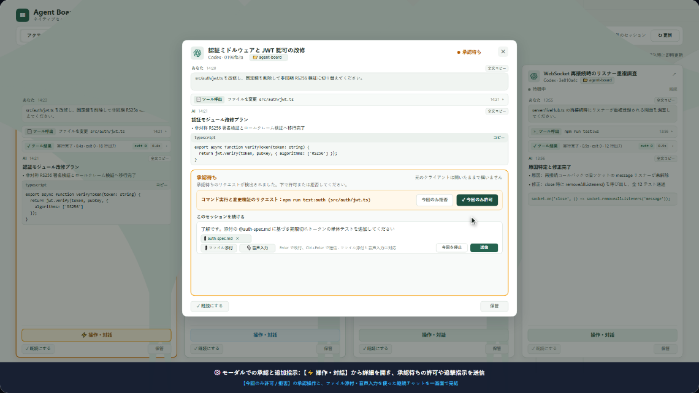

# Agent Board

<p align="center">
  <strong>ローカルマルチエージェントセッショングリッドダッシュボード · ネイティブセッションを一元管理</strong>
</p>

<p align="center">
  <a href="README.md">English</a> | <a href="README_zh.md">简体中文</a> | <a href="README_zh-TW.md">繁體中文</a> | <strong>日本語</strong>
</p>

<p align="center">
  
  
  
  
  
</p>

<p align="center">
  <video src="docs/promo-video-ja.webm" poster="docs/promo-video-preview-ja.png" width="850" controls autoplay loop muted playsinline>
    <a href="promo-video/index.html?lang=ja-JP" title="クリックして 60 FPS プロモーション実演動画を再生">
      
    </a>
  </video>
  <br />
  <em>🎬 <b>インタラクティブ 60 FPS 実演動画</b>：日本語版 1080p 実演動画（ブラウザ内で直接再生可能）。動画をクリックするかブラウザで <a href="promo-video/index.html?lang=ja-JP"><code>promo-video/index.html</code></a> を直接開いて、ターミナルストリーミング、インプレース承認、音声シンセサイザーを含む完全なシミュレーションを体験できます（日本語 / EN / 简 / 繁 対応）。</em>
</p>

**Agent Board** は、ローカル環境で複数の AI コーディングエージェントを並行して運用する開発者のための、軽量かつ非侵入型なダッシュボードです。**Codex**、**Claude Code**、**Antigravity** を完全にサポートし、オリジナルのターミナルや IDE インスタンスを停止・乗っ取ることなく、マシン内の全セッションを自動検出。安定したグリッドビューで進行状況をリアルタイムに追跡し、対話モーダルから双方向の入力や承認を行えます。

---

## 🎬 プロモーション動画＆ライブデモ

Agent Board のリアルタイムワークフロー実演をご覧ください：
- **インタラクティブプレーヤー**：任意のブラウザで [`promo-video/index.html`](promo-video/index.html) を直接開くだけで再生可能（サーバー不要・完全オフライン対応）。
- **主要チャプター構成**：
  - `00:00` **リアルタイムストリーミング追跡**：複数エージェントのログを同画面で追跡。サブピクセル自動スクロールと回転する CLI スピナー。
  - `04:00` **2軸状態管理**：実行ステータス（*実行中 / 承認待ち / 完了*）と閲覧状態（*新規未読 / 完了未読 / 既読*）を明確に分離。承認待ちカードはゴールドに脈動。
  - `07:12` **インプレース直接対話**：`write_to_file` を検知してコード差分を表示し、ワンクリックで【実行を許可】して元プロセスをそのまま進行。
  - `10:30` **確認と保管のサイクル**：ワンクリックで【既読にする】、完了後に【保管】。新しいログが書き込まれると自動で復元。
  - `13:12` **ローカルファーストとオープンソース**：ループバック（`127.0.0.1`）に厳格制限、データ漏洩ゼロ、MIT ライセンス。
- **完全多言語対応（i18n）**：🇯🇵 **日本語**、🇺🇸 **English**、🇨🇳 **簡体中文**、🇭🇰 **繁體中文** をプレーヤー上でいつでも瞬時に切り替え可能。
- **高画質エクスポート機能**：1080p 60 FPS 動画（WebM/MP4）の書き出しや 1080p スクリーンショット保存を標準搭載。

---

## 🌟 主な機能

- 🔍 **ゼロコンフィグ自動検出**：起動するだけで `%USERPROFILE%\.codex\sessions`、`.claude\projects`、Antigravity のネイティブログを自動スキャン。手動インポートは不要です。
- ⚡ **リアルタイムストリーム追跡**：ネイティブ JSONL ログを直接追跡。第三者データベースへの二重保存やセッション複製を行わず、Markdown 描画やツール実行ログの折りたたみ表示に対応。
- 🎮 **ネイティブ双方向対話制御**：
  - **OpenAI Codex**：VS Code やデスクトップ版で実行中のローカル IPC に自動接続。テキスト送信、コマンド／ファイル承認、選択肢への回答、ターンの割り込み中断をサポート。
  - **Anthropic Claude Code**：ゼロタッチの VS Code 透過 `stdin/stdout` ブリッジ（`agent-board-bridge`）およびスタンドアロン MCP Channels モード（`claude-board`）を搭載。人間ユーザーの権限での指示送信、ファイル編集の Unified Diff 差分プレビュー＆承認、コマンド実行許可、対話型質問への回答（`AskUserQuestion`）、および VS Code 側の承認カードとの双方向リアルタイム同期を実現。
  - **Antigravity**：ネイティブワークスペースの検出と `language_server.exe` による直接ターン送信に対応。
- ➕ **ワンクリック新規セッション作成＆マルチモーダル添付**：ボード上から Codex、Claude Code、Antigravity の新規セッションを直接起動（ワークスペース・モデル・権限選択対応）でき、対話モーダルへの画像やファイルの貼り付け・アップロードにも対応。
- 🛡️ **プライバシーとセキュリティ**：
  - ローカルループバックアドレス（`127.0.0.1`）のみで待受を行い、厳格な Host / Origin 検証により CSRF や LAN からの不正アクセスを遮断；
  - 権限の無断昇格やツールの自動承認は行わず、重要な操作には常にユーザー確認を要求；
  - ローカル SQLite は既読位置や並び順などの表示用メタデータのみを保存し、会話本文やトークンは保持しません。
- 🌐 **多言語対応（i18n）**：日本語（`ja-JP`）、英語（`en-US`）、簡体字中国語（`zh-CN`）、繁体字中国語（`zh-TW`）のスムーズな切り替えをサポート。
- 📱 **快適なグリッドレイアウト**：カードごとに独立したスクロール領域、ステータス絞り込み、既読管理、ダッシュボードアーカイブ機能を搭載。

---

## 🚀 クイックスタート

### 動作環境
- **Node.js** >= 22.13.0

### インストールと起動

```powershell
# 1. リポジトリのクローン
git clone https://github.com/gusikows5/agent-board.git
cd agent-board

# 2. 依存関係のインストールとビルド
npm install
npm run build

# 3. ダッシュボードの起動
npm start
```

ブラウザで **http://127.0.0.1:4317** を開きます。

> [!NOTE]
> セキュリティ保護のため、本サービスはループバックアドレス（`127.0.0.1`）でのみ通信を受け付けます。LAN IP でのアクセスは無効化されています。開発時は `npm run dev` でバックエンドを監視できます。

---

## 🖥️ デスクトップクライアント (Electron)

Agent Board は、ゼロコンフィグですぐに使えるネイティブのクロスプラットフォーム・デスクトップアプリケーションとしても動作します。

### デスクトップ版の起動
```powershell
# ビルドしてデスクトップ版を起動
npm run desktop

# ビルド済みの場合に直接起動：
npm run desktop:start
```

### マルチプラットフォームのパッケージングと配布
`electron-builder` により各 OS 向けのインストーラーを生成できます：

```powershell
# Windows：NSIS セットアップインストーラー (.exe) の生成
npm run dist:win

# Windows：ポータブル展開ディレクトリの生成
npm run pack:dir

# macOS：.dmg および .zip の生成 (Apple Silicon arm64 & Intel x64)
npm run dist:mac

# Linux：.AppImage および .deb の生成
npm run dist:linux

# 全プラットフォーム一括ビルド
npm run dist:all
```
生成されたインストーラーや実行ファイルは `dist-desktop/` に出力されます。

### デスクトップ版専用機能
- 🚀 **内蔵バックグラウンドサーバー**：Electron の `utilityProcess` により Node.js バックエンドを分離管理。コンソールウィンドウを表示せず、アプリの起動・終了と完全に連動します。
- 🔔 **承認待ちシステム通知**：いずれかのエージェントが承認待ち・入力待ち（`WAITING_APPROVAL` / `WAITING_INPUT`）になると OS ネイティブ通知を自動表示し、クリックで該当カードへ即座にフォーカスします。
- 📌 **システムトレイ常駐**：トレイへの最小化、サーバーステータス確認、標準ブラウザでの表示、サーバー再起動、安全な終了に対応。
- 📐 **ウィンドウ状態の自動保存**：前回のウィンドウサイズ、表示位置、最大化状態を自動的に記憶・復元。
- 🌐 **クロスプラットフォーム IPC 対応**：Windows の名前付きパイプ（`\\.\pipe\codex-ipc`）および macOS/Linux の Unix ドメインソケット（`/tmp/codex-ipc`）にシームレスに接続。

---

## 🔌 エージェントセッションの接続と対話

すべての検出済みセッションに対して、**初期状態でゼロコンフィグのリアルタイム監視（読み取り専用）**が有効です。Web 画面からメッセージ送信や承認を行う場合は、以下のように連携します：

### 1. OpenAI Codex
- **完全設定不要**：VS Code または Codex デスクトップで該当セッションを開くと、ダッシュボードの対話モーダルがアクティブなローカル IPC を自動認識して接続します。
- テキスト指示の送信、コマンド／ファイル書き込みの承認・拒否、選択肢回答、実行中ターンの停止に対応。

### 2. Anthropic Claude Code
Claude Code の仕様では、外部の名前付きパイプ（Named Pipe）は信頼されないサブエージェント通信（`kind: "peer"`）として扱われるため、プロンプトインジェクション警告が強制挿入され、VS Code のチャット画面には通常のユーザー吹き出しとして表示されません。**完全な人間ユーザーの権限を持ち、VS Code 上で正常にチャット表示される唯一の経路は標準入力（`stdin`）です。**

そのため、Agent Board には Go 標準ライブラリのみで実装された透過的な標準入出力マルチプレクサ・ブリッジ（ソースコード：[`bridge/main.go`](bridge/main.go)）が組み込まれており、**特別な起動コマンド不要で完全にシームレスな双方向対話とインプレース承認**を実現しています：

#### 方法 A（推奨）：VS Code 透過標準入力ブリッジ（普段のコマンド操作ゼロ）
- **デスクトップ版（自動内蔵）**：コンパイル済みの `agent-board-bridge.exe` が Electron デスクトップ版のパッケージ内（`resources/bin/agent-board-bridge.exe`）に直接同梱されています。起動時（またはシステムトレイメニュー → **Setup Claude Bridge**）に、`~/.claude/agent-board-bridge.exe` への配置と VS Code 設定が自動で行われます。
- **CLI ワンクリックビルド＆設定**：
  ```powershell
  # bridge/main.go を自動コンパイル（要 Go 環境）し、VS Code の settings.json を自動設定
  npm run setup:bridge
  ```
- **VS Code の手動設定**：
  VS Code のユーザー設定 `%APPDATA%\Code\User\settings.json` に以下を追加します：
  ```json
  "claudeCode.claudeProcessWrapper": "C:\\Users\\<ユーザー名>\\.claude\\agent-board-bridge.exe"
  ```
- **普段の使い方と対応機能**：いつも通り VS Code で Claude Code パネルを開くだけです！**ターミナルでの特別なコマンドやフラグは一切不要です**：
  - Agent Board から送信したメッセージは Claude の標準入力に直接注入され、VS Code のチャット画面にリアルタイム表示され、完全な人間ユーザーの権限で実行されます；
  - ツール実行の権限確認リクエスト（`Edit` / `MultiEdit` / `Write` ファイル編集、`Bash` コマンド実行）や対話型質問（`AskUserQuestion`）をリアルタイムに検知し、シンタックスハイライト付きの Unified Diff 差分表示や承認・回答カードを Agent Board 上に表示します；
  - Agent Board 側で【許可 / 拒否】すると VS Code 側の承認カードも自動的に閉じられ（重複応答も自動抑止）、逆に VS Code 側で承認した場合も Agent Board の待機状態が即座にクリアされます。

#### 方法 B：スタンドアロン・ターミナル MCP Channel モード（`claude-board`）
VS Code 以外の純粋なターミナル環境で使用する場合は、公式 MCP Channels ウィザードによる連携も利用可能です：
```powershell
npm run setup
claude-board
```

### 3. Google Antigravity
- **完全設定不要**：ローカルの `~/.gemini/antigravity/brain` セッションを自動検出し、公式の `language_server.exe agentapi send-message` インターフェースを通じて完全なユーザー権限で直接メッセージを送信します。

---

## 📐 アーキテクチャと設計思想

| 観点 | 設計方針と原則 |
| :--- | :--- |
| **信頼できる唯一の情報源** | ネイティブのセッションログが唯一の真実です。ダッシュボードが元ファイルを変更・偽装することはありません。 |
| **クライアントのライフサイクル** | オリジナルのターミナル／IDE は常に開いたまま動作します。ダッシュボードを再起動・終了しても、外部エージェントプロセスに一切影響しません。 |
| **ステータスの分離** | 実行状態（実行中／入力待ち／完了）と閲覧状態（既読／未読／アーカイブ）は完全に分離されています。 |
| **データ境界** | `%LOCALAPPDATA%\AgentBoard\board.sqlite` には表示順や既読カーソルのみを保存し、チャット本文や認証トークンは含みません。 |

---

## ⚙️ 環境変数設定

起動時に以下の環境変数で設定をカスタマイズできます：

| 変数名 | デフォルト値 | 説明 |
| :--- | :--- | :--- |
| `AGENT_BOARD_PORT` | `4317` | ローカル待受ポート |
| `AGENT_BOARD_CODEX_HOME` | `%USERPROFILE%\.codex` | Codex セッション・設定ディレクトリ |
| `AGENT_BOARD_CLAUDE_HOME` | `%USERPROFILE%\.claude` | Claude セッション・設定ディレクトリ |
| `AGENT_BOARD_ANTIGRAVITY_HOME` | `%USERPROFILE%\.gemini\antigravity` | Antigravity 記録ディレクトリ |
| `AGENT_BOARD_DATA` | `%LOCALAPPDATA%\AgentBoard` | Agent Board SQLite データ保存先 |

---

## 🧪 検証と品質保証

本プロジェクトは実プロトコル検証と合成サンドボックスによる統合テストを実施しています：

```powershell
# 型チェック
npm run typecheck

# 本番ビルド
npm run build

# 多言語辞書構造およびブラウザ描画チェック
npm run verify:i18n

# Claude Code 透過ブリッジ承認・Diff・対話質問の E2E 検証
npm run verify:claude-approval

# マルチモーダル添付ファイルのアップロード＆ライフサイクル検証
npm run verify:attachments

# ローカル IPC & MCP プロトコル対話検証
node scripts/verify-live-interaction.mjs

# HTTP エンドポイント、セキュリティ、ライフサイクル検証
npm run verify:http
```

---

## 📄 ライセンス

本プロジェクトは [MIT ライセンス](LICENSE) のもとで公開されています。
