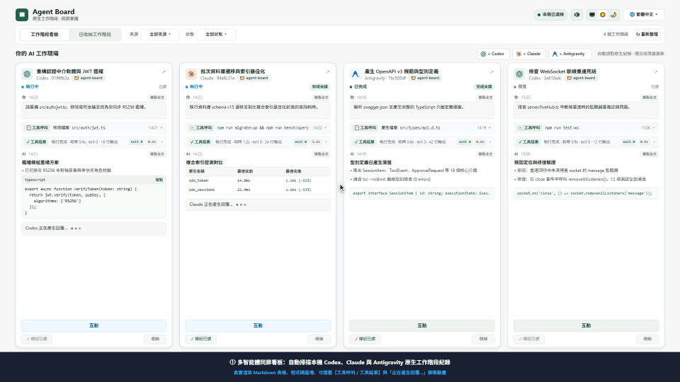

# Agent Board · 工作階段看板

<p align="center">
  <strong>本機多代理會話網格看板 · 原生會話 · 同螢幕掌握</strong>
</p>

<p align="center">
  <a href="README.md">English</a> | <a href="README_zh.md">简体中文</a> | <strong>繁體中文</strong> | <a href="README_ja.md">日本語</a>
</p>

<p align="center">
  
  
  
  
  
</p>

<p align="center">
  <a href="https://useless-lab-ai.github.io/agent-board/promo-video/index.html?lang=zh-TW" title="點擊開啟 60 FPS 互動式線上宣傳展示播放器">
    
  </a>
  <br />
  <em>🎬 <b>60 FPS 即時動態展示影片</b>：上方為繁體中文版自動循環展示動圖；點擊畫面或開啟 <a href="https://useless-lab-ai.github.io/agent-board/promo-video/index.html?lang=zh-TW"><b>60 FPS 線上互動式展示播放器</b></a>（本機檔案：<a href="promo-video/index.html?lang=zh-TW"><code>promo-video/index.html</code></a>）體驗含即時終端機串流、原位程式碼 Diff 審批與合成音效的完整展示（支援 繁 / 簡 / EN / 日本語）。</em>
</p>

**Agent Board** 是一款輕量、免侵入式的本機 AI 會話聚合與互動看板。專為高頻使用 **Codex**、**Claude Code** 及 **Antigravity** 的開發者打造。它能在不干擾原始客戶端、不託管或強制終止處理程序、不上傳任何資料的前提下，自動探索本機所有會话，在同螢幕網格中即時追蹤多代理執行進度，並於對話框中提供雙向互動與審批能力。

---

## 🌟 核心特色

- 🔍 **零設定全自動探索**：開箱即用，自動掃描本機 `%USERPROFILE%\.codex\sessions`、`.claude\projects` 及 Antigravity 原生紀錄，無需手動匯入。
- ⚡ **即時串流追蹤**：直接讀取原生 JSONL / 紀錄串流，不建立第三方資料庫副本，不製造重複會話；卡片支援 Markdown 渲染與工具呼叫展開收合。
- 🎮 **原生雙向互動控制**：
  - **Codex**：自動連接已在桌面端 / VS Code 執行中的本機 IPC 會話，支援文字輸入、命令與檔案寫入審批、結構化問答以及輪次中斷。
  - **Claude Code**：內建 VS Code 無感透明標準輸入/輸出橋接器（`agent-board-bridge`）及獨立終端機 MCP Channels 模式（`claude-board`），支援傳送真人權限指令、程式碼修改 Unified Diff 預覽與審批、命令執行授權、互動式選擇題作答（`AskUserQuestion`），並與 VS Code 本機權限卡片雙向即時同步消隱。
  - **Antigravity**：深度支援原生工作區會話識別與真實使用者回合指令連動。
- ➕ **一鍵新增會話與多模態附件**：支援在看板中直接建立 Codex、Claude Code 或 Antigravity 新會話（自選工作目錄、模型與權限模式），並在互動對話框中貼上或上傳圖片與檔案附件。
- 🛡️ **嚴格的隱私與安全機制**：
  - 僅監聽本機迴環位址（`127.0.0.1`），啟用嚴格的 Host / Origin 驗證，杜絕跨站與區域網路威脅；
  - 絕不擅自越權執行工具，所有敏感操作嚴格保留人工確認流程；
  - 本機 SQLite 僅儲存已讀標記、看板排列等展示用中繼資料，不留存聊天內文。
- 🌐 **完整多語系支援（i18n）**：介面支援繁體中文（`zh-TW`）、簡體中文（`zh-CN`）、英語（`en-US`）與日語（`ja-JP`）平滑切換，偏好設定自動持久化。
- 📱 **整齊的網格版面**：採用穩定換行的卡片網格佈局，卡片間具備獨立捲動區域；支援依狀態篩選、標記已讀與看板封存。

---

## 🚀 快速上手

### 環境需求
- **Node.js** >= 22.13.0

### 安裝與啟動

```powershell
# 1. 複製儲存庫
git clone https://github.com/Useless-Lab-AI/agent-board.git
cd agent-board

# 2. 安裝相依套件並建置
npm install
npm run build

# 3. 啟動看板服務
npm start
```

啟動後於瀏覽器中開啟：**http://127.0.0.1:4317**。

> [!NOTE]
> 為確保安全，服務僅綁定本機迴環位址，請使用 `127.0.0.1` 存取，切勿使用區域網路 IP。開發模式可執行 `npm run dev` 監看後端變更。

---

## 🖥️ 桌面客戶端 (Electron)

Agent Board 支援作為功能完備的原生跨平台桌面客戶端執行，全平台零設定開箱即用。

### 執行桌面端
```powershell
# 建置並啟動桌面端
npm run desktop

# 或在已建置狀態下直接啟動：
npm run desktop:start
```

### 多平台打包與發佈
基於 `electron-builder` 建置，已內建高速鏡像加速管道：

```powershell
# Windows：生成 NSIS 一鍵安裝包 (.exe)
npm run dist:win

# Windows：生成免安裝綠色目錄 (快捷便攜測試)
npm run pack:dir

# macOS：生成 DMG 與 ZIP 套件 (支援 Apple Silicon arm64 與 Intel x64)
npm run dist:mac

# Linux：生成 AppImage 與 Debian (.deb) 安裝套件
npm run dist:linux

# 全平台打包 (在支援的系統或 CI 環境下)
npm run dist:all
```
產出的安裝檔與執行檔位於 `dist-desktop/` 目錄。

### 桌面端專屬增強功能
- 🚀 **內建背景服務託管**：透過 Electron `utilityProcess` 獨立行程管理 Node.js 後端，無黑視窗彈出，隨應用程式同生共死。
- 🔔 **系統級審批通知**：當任意代理會話觸發 `WAITING_APPROVAL` 或 `WAITING_INPUT` 審批等待時，自動彈出系統原生通知，點擊直達對應會話卡片。
- 📌 **系統匣常駐**：支援視窗最小化至系統匣、選單快速檢視服務狀態、一鍵於預設瀏覽器開啟、平滑重啟服務與結束。
- 📐 **視窗位置與狀態記憶**：自動持久化上次視窗尺寸、座標與最大化狀態。
- 🌐 **全平台 IPC 通訊相容**：Windows 具名管道（`\\.\pipe\codex-ipc`）與 macOS/Linux Unix Domain Socket（`/tmp/codex-ipc`）無縫適配。

---

## 🔌 連接代理會話以進行互動

看板對所有原生會話預設提供**零設定唯讀監控**。如需直接在看板網頁中向代理傳送訊息與處理審批：

### 1. OpenAI Codex
- **完全免設定**：在 VS Code 或 Codex 桌面端開啟目標會話後，看板彈出視窗會自動識別本機使用中的 IPC 並建立連線；
- 支援傳送對話文字、允許/拒絕命令與檔案寫入、提交多選題答案，以及中斷當前輪次。

### 2. Anthropic Claude Code
在 Claude Code 機制下，外部原生具名管道（Named Pipe）被嚴格定義為不可信的多代理協作通道（`kind: "peer"`），從管道注入的訊息會被強制加上防提示詞注入免責警告，且被 VS Code 前端過濾隱藏，不具備真人審批權限。**唯一被視為 100% 真實人類使用者權限並能在 VS Code 正常渲染對話氣泡的通道是標準輸入（`stdin`）。**

為此，Agent Board 內建了以純 Go 標準庫編寫的透明標準輸入/輸出多路複用橋接器（原始碼位於 [`bridge/main.go`](bridge/main.go)），實現**完全無感、零特殊啟動命令**的雙向互動與原位審批體驗：

#### 方式 A（強烈推薦）：VS Code 無感透明標準輸入橋接（日常零命令）
- **桌面端（全自動內建）**：編譯好的 `agent-board-bridge.exe` 已直接打包進 Electron 桌面端安裝套件中（`resources/bin/agent-board-bridge.exe`）。桌面端啟動時（或點擊系統匣選單 → **配置 Claude VS Code 橋接**），會自動將橋接程式安裝至 `~/.claude/agent-board-bridge.exe` 並完成 VS Code 設定。
- **命令列一鍵建置與設定**：
  ```powershell
  # 自動編譯 bridge/main.go（需本機安裝 Go）並自動寫入 VS Code settings.json
  npm run setup:bridge
  ```
- **手動設定 VS Code**：
  在 VS Code 使用者設定 `%APPDATA%\Code\User\settings.json` 中新增：
  ```json
  "claudeCode.claudeProcessWrapper": "C:\\Users\\<你的使用者名稱>\\.claude\\agent-board-bridge.exe"
  ```
- **日常使用與完整能力**：直接像往常一樣在 VS Code 中開啟 Claude Code 面板即可！**無需執行任何命令列或附加參數**：
  - 從 Agent Board 看板傳送的訊息將直接注入 Claude 的標準輸入，在 VS Code 聊天視窗即時同步呈現，並擁有完整的真人使用者權限；
  - 即時攔截工具權限審批請求（`Edit` / `MultiEdit` / `Write` 程式碼修改、`Bash` 命令執行）與互動式提問（`AskUserQuestion`），在看板中渲染語法高亮的 Unified Diff 對比檢視與審批/答題卡片；
  - 在看板中點擊【允許 / 拒絕】會自動收起 VS Code 本機的權限審批卡片（並自動攔截去重），在 VS Code 本機完成審批也會即時消除看板的等待狀態。

#### 方式 B：獨立終端機 MCP Channel 模式（`claude-board`）
若在 VS Code 之外的純命令列終端機中使用，也可透過官方 MCP Channels 精靈接入：
```powershell
npm run setup
claude-board
```

### 3. Google Antigravity
- **完全零設定**：自動發現本機 `~/.gemini/antigravity/brain` 會話，透過官方 `language_server.exe agentapi send-message` 介面直接傳送真實使用者回合指令，具備完整使用者權限。

---

## 📐 架構原則與設計邊界

| 維度 | 設計規範與原則 |
| :--- | :--- |
| **事實來源** | 原生會話紀錄為唯一事實來源。看板絕不修改、替換原生檔案，亦不偽造歷史。 |
| **客端生命週期** | 原始終端機/客戶端始終保持開啟，無需「交接」。關閉或重啟看板絕不影響外部代理處理程序。 |
| **狀態分離** | 執行狀態（執行中/等待中/已完成）與閱讀狀態（已讀/未讀/封存）嚴格解耦。 |
| **資料邊界** | 本機資料庫位於 `%LOCALAPPDATA%\AgentBoard\board.sqlite`，僅存卡片游標與閱讀偏好，無聊天內文或 Token 副本。 |

---

## ⚙️ 環境變數設定

啟動服務時可透過環境變數自訂執行參數：

| 變數名稱 | 預設值 | 說明 |
| :--- | :--- | :--- |
| `AGENT_BOARD_PORT` | `4317` | 本機服務監聽連接埠 (Port) |
| `AGENT_BOARD_CODEX_HOME` | `%USERPROFILE%\.codex` | Codex 本機設定與會話根目錄 |
| `AGENT_BOARD_CLAUDE_HOME` | `%USERPROFILE%\.claude` | Claude 本機設定與會話根目錄 |
| `AGENT_BOARD_ANTIGRAVITY_HOME` | `%USERPROFILE%\.gemini\antigravity` | Antigravity 本機紀錄根目錄 |
| `AGENT_BOARD_DATA` | `%LOCALAPPDATA%\AgentBoard` | 看板 SQLite 中繼資料存放路徑 |

---

## 🧪 驗證與品質保證

專案遵循無單元測試、高強度整合驗證規格，透過真實通訊端點與合成沙箱進行驗收：

```powershell
# 型別檢查
npm run typecheck

# 生產環境建置
npm run build

# 多語系字典結構一致性與瀏覽器渲染檢驗
npm run verify:i18n

# Claude Code 透明橋接審批、程式碼 Diff 與互動答題端到端驗證
npm run verify:claude-approval

# 多模態附件上傳與生命週期驗證
npm run verify:attachments

# 本機 IPC & MCP 通訊協議互動驗證
node scripts/verify-live-interaction.mjs

# HTTP 端點、安全沙箱與狀態串流完整性檢驗
npm run verify:http
```

---

## 📄 開源授權

本專案採用 [MIT 授權條款](LICENSE)。
