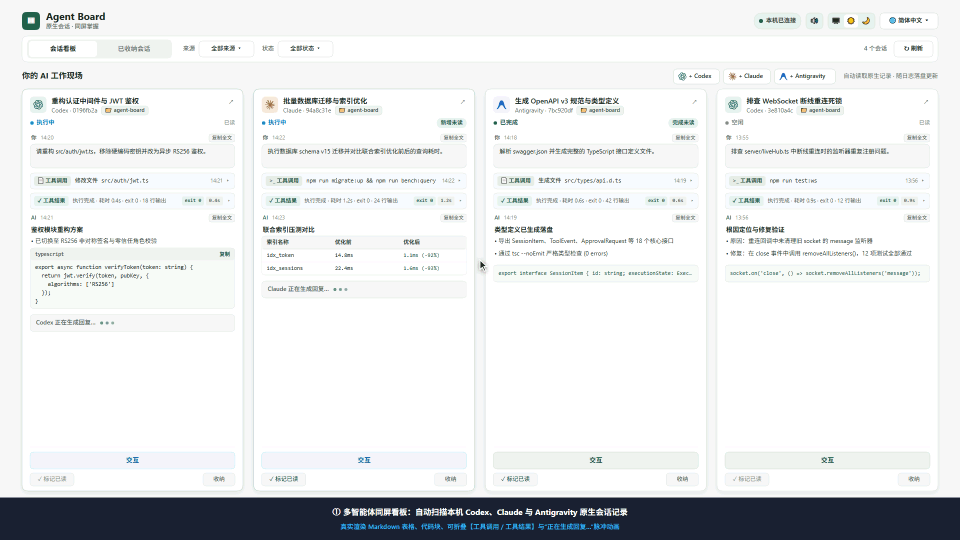
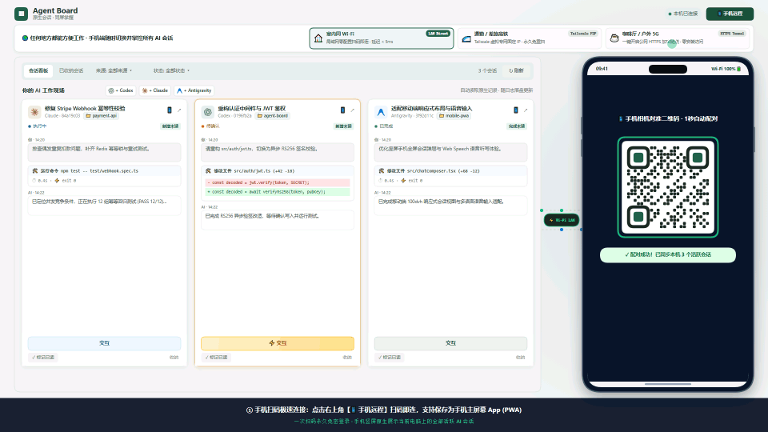

# Agent Board · 会话看板

<p align="center">
  <strong>本地多智能体会话网格看板 · 原生会话 · 同屏掌握</strong>
</p>

<p align="center">
  <a href="README.md">English</a> | <strong>简体中文</strong> | <a href="README_zh-TW.md">繁體中文</a> | <a href="README_ja.md">日本語</a>
</p>

<p align="center">
  
  
  
  
  
</p>

<p align="center">
  <a href="https://useless-lab-ai.github.io/agent-board/promo-video/index.html?lang=zh-CN" title="点击打开 60 FPS 交互式在线宣传演示播放器">
    
  </a>
  <br />
  <em>🎬 <b>60 FPS 实时动态演示视频</b>：上方为简体中文版自动循环演示动图；点击画面或打开 <a href="https://useless-lab-ai.github.io/agent-board/promo-video/index.html?lang=zh-CN"><b>🖥️ 桌面看板全景演示播放器</b></a>（本地：<a href="promo-video/index.html?lang=zh-CN"><code>promo-video/index.html</code></a>）| <a href="https://useless-lab-ai.github.io/agent-board/promo-video/mobile.html?lang=zh-CN"><b>📱 手机远程·随处工作·语音输入演示播放器</b></a>（本地：<a href="promo-video/mobile.html?lang=zh-CN"><code>promo-video/mobile.html</code></a>）。</em>
</p>

**Agent Board** 是一款轻量、免侵入的本地 AI 会话聚合与交互看板。专为高频使用 **Codex**、**Claude Code** 及 **Antigravity** 的开发者设计。它能够在不干扰原客户端、不托管杀死进程、不上传任何数据的原则下，自动发现本机所有会话，在同屏网格中实时追踪多会话进度，并在弹层中提供双向交互与审批。

---

## 🌟 核心特性

- 🔍 **零配置全自动发现**：开箱即用，自动扫描本机 `%USERPROFILE%\.codex\sessions`、`.claude\projects` 及 Antigravity 原生记录，无需手动导入。
- ⚡ **实时日志追踪**：直接读取原生 JSONL / 记录流，不建立第三方数据库副本，不制造重复会话；卡片支持 Markdown 渲染与工具调用折叠展开。
- 🎮 **原生双向交互控制**：
  - **Codex**：自动连接已有桌面端 / VS Code 运行中的本地 IPC 会话，支持文本输入、命令/文件审批、结构化答题与轮次中断。
  - **Claude Code**：内置 VS Code 无感透明标准输入/输出桥接器（`agent-board-bridge`）及独立终端 MCP Channels 模式（`claude-board`），支持发送真人权限指令、代码修改 Unified Diff 预览与审批、命令执行授权、交互式选择题作答（`AskUserQuestion`），并与 VS Code 本地权限卡片双向实时同步消隐。
  - **Antigravity**：深度支持原生工作空间会话识别与真实用户回合指令联动。
- ➕ **一键新建会话与多模态附件**：支持在看板中直接创建 Codex、Claude Code 或 Antigravity 新会话（自选工作目录、模型与权限模式），并在交互弹层中粘贴或上传图片及文件附件。
- 📲 **手机扫码远程控制 & 桌面 App (PWA)**：顶部工具栏及每张会话卡片均内置**手机远程控制二维码**，支持 **局域网 / Tailscale 直连**、**一键公网 HTTPS 隧道**、**自定义域名** 三种模式；手机扫码即可实时接力对话、审批命令与 Diff，支持**多语言实时语音输入（🎙️ 动口不动手）**，并可一键**添加到手机主屏幕**作为独立全屏 App 运行。
- 🛡️ **严格的隐私与安全保护**：
  - 本机回环（`127.0.0.1`）免密直连；外部网络请求强制启用 **256-bit 随机令牌（Token）+ HttpOnly Cookie 鉴权** 与严格的 Host / Origin 校验，支持一键重置令牌踢出所有远端设备；
  - 绝不自动越权执行工具，所有敏感操作严格保留人工确认流程；
  - 本地 SQLite 仅存储已读标记、看板排列等展示元数据，不持久化聊天正文。
- 🌐 **完整多语言支持（i18n）**：界面支持简体中文（`zh-CN`）、繁体中文（`zh-TW`）、英语（`en-US`）与日语（`ja-JP`）实时平滑切换，状态与偏好自动持久化。
- 📱 **规整的网格交互**：采用稳定换行的卡片网格布局，卡片间独立滚动；支持按状态过滤、全文检索、标记已读与看板归档。

---

## 🚀 快速上手

### 环境要求
- **Node.js** >= 22.13.0

### 安装与启动

```powershell
# 1. 克隆代码仓库
git clone https://github.com/Useless-Lab-AI/agent-board.git
cd agent-board

# 2. 安装依赖并构建
npm install
npm run build

# 3. 启动看板服务
npm start
```

启动后在电脑浏览器中打开：**http://127.0.0.1:4317**。

> [!NOTE]
> 本机浏览器请直接使用 `http://127.0.0.1:4317` 免密访问；如需用手机或其他设备远程访问，请点击看板右上角的 **「📱 手机远程」** 按钮扫码连接（未经授权直接访问局域网 IP 会被安全守卫拦截）。开发模式可执行 `npm run dev` 监视后端。

---

## 📱 手机远程控制与桌面 App (PWA)

<p align="center">
  <a href="https://useless-lab-ai.github.io/agent-board/promo-video/mobile.html?lang=zh-CN" title="点击打开 60 FPS 手机远程连接·随处办公·多语言语音输入交互演示播放器">
    
  </a>
  <br />
  <em>📱 <b>手机扫码极速连接 · 竖屏多会话自由切换 · 随处移动办公 · 🎙️ 多语言实时语音输入</b>：点击上方动图或打开 <a href="https://useless-lab-ai.github.io/agent-board/promo-video/mobile.html?lang=zh-CN"><b>60 FPS 手机随行交互演示播放器</b></a>（本地文件：<a href="promo-video/mobile.html?lang=zh-CN"><code>promo-video/mobile.html</code></a> · 高清视频：<a href="docs/promo-mobile-zh.webm"><code>docs/promo-mobile-zh.webm</code></a>）体验扫码配对、竖屏多会话列表切换、Wi-Fi / Tailscale / 5G 跨网随行、实时语音转文字下达指令与手机一键审批双向同步。</em>
</p>

点击看板右上角的 **「📱 手机远程」** 按钮（或任意会话卡片右上角的 `📱` 图标），即可打开手机远程控制面板。Agent Board 提供 **三种远程连接方式**，满足室内与户外全场景需求：

| 连接方式 | 适用场景 | 网络要求 | 地址持久性 | 推荐指数 |
| :--- | :--- | :--- | :--- | :--- |
| **1. 局域网 / Tailscale 直连** | 同 Wi-Fi 室内，或 **装有 Tailscale 的全网跨网环境** | 同一局域网，或双方开启 **Tailscale** | **永久固定**（配合 Tailscale） | ⭐⭐⭐⭐⭐ **（强烈推荐）** |
| **2. 公网 HTTPS 隧道** | 未装组网工具时的临时户外 4G/5G 蜂窝网络访问 | 电脑能上网即可，手机零配置 | 每次开启随机生成新域名 | ⭐⭐⭐⭐ |
| **3. 自定义域名 / 反向代理** | 自有云服务器 FRP / Cloudflare Zero Trust / DDNS | 用户自建反向代理或 MagicDNS | 永久固定 | ⭐⭐⭐ |

### 🌟 最佳实践：为什么强烈推荐 Tailscale + PWA？
1. **方式一：局域网 / Tailscale 直连（推荐首选）**
   - **同 Wi-Fi 零配置**：手机与电脑连同一个 Wi-Fi 时，扫码即连，延迟 `< 5ms`。
   - **Tailscale 全天候跨网（强烈推荐）**：在电脑和手机上安装免费的 [Tailscale](https://tailscale.com/) 并登录同一账号后，Agent Board 会自动识别 `100.64.0.0/10` 网段的 **Tailscale 虚拟网卡**（并在网卡下拉框中自动标注 `· Tailscale`）。
   - **永不过期、无需重扫**：Tailscale 为你的电脑分配**永久固定的 `100.x.x.x` IP**，点对点 WireGuard 加密直连，不经过第三方中转减速。无论你在家连 Wi-Fi 还是出门用 5G 流量，**永远不需要重新扫码或重启隧道**！
2. **方式二：公网 HTTPS 隧道（零安装临时救急）**
   - 当你在外使用 5G 流量且未安装 Tailscale 时，在弹层中开启 **「公网 HTTPS 隧道」** 开关，后端会自动调用本机 `cloudflared`（Cloudflare TryCloudflare）或系统自带 `ssh`（`localhost.run`）在几秒内生成一条加密公网 `https://xxx` 链接并自动刷新二维码。
3. **方式三：自定义域名 / 反向代理**
   - 若你已配置 Tailscale MagicDNS（如 `https://my-pc.tailxxxx.ts.net`）或自建反向代理，可在 **「自定义域名」** 模式下填入固定外部地址，自动拼装安全令牌并生成二维码。

### 📲 竖屏多会话切换、语音输入与手机桌面 App (PWA)
- **竖屏多会话列表与自由切换**：手机端专为竖屏单手操作优化，首页展示当前电脑上的全部活跃会话卡片；点击卡片上的 **「交互」** 即可进入 `100dvh` 全屏会话详情，点击左上角 **`← 返回列表`** 即可随时切回看板并切换至其他 Codex、Claude 或 Antigravity 会话。
- **🎙️ 多语言实时语音输入**：会话输入框内置 **「🎙️ 语音输入」** 按钮，支持中文、English、日本語等多语言实时语音转文字（Speech-to-Text），出门在外或通勤路上动口不动手即可高效下达研发指令。
- **单会话扫码接力**：点击任意会话卡片右上角的 `📱` 按钮，二维码会自动指向该会话专属深链（`?session=<id>`），手机扫码后**直接全屏弹出该会话的聊天与审批界面**，电脑端可无缝切换到手机端继续对话。
- **安装到手机桌面（PWA）**：
  - **iOS (Safari)**：扫码打开网页后，点击底部 **「分享」** 按钮 $\rightarrow$ 选择 **「添加到主屏幕」**；
  - **Android (Chrome / Edge)**：扫码打开网页后，点击右上角菜单 $\rightarrow$ 选择 **「安装应用」** 或 **「添加到主屏幕」**。
  - 动态生成的 `manifest.webmanifest` 已自动内置你的专属访问令牌（`start_url`），从手机桌面图标启动时具备**独立全屏原生 App 体验**（无浏览器地址栏）且**永久免重新扫码登录**。
- **令牌重置与安全防护**：远程设置（开启隧道、重置令牌）仅限电脑本机操作；一旦点击 **「重置令牌」**，旧二维码与已安装的远端会话立即失效。

---

## 🖥️ 桌面客户端 (Electron)

Agent Board 支持作为功能完备的原生跨平台桌面客户端运行，全平台零配置开箱即用。

### 运行桌面端
```powershell
# 构建并启动桌面端
npm run desktop

# 或在已构建状态下直接启动：
npm run desktop:start
```

### 多平台打包与分发
基于 `electron-builder` 构建，已内置国内高可靠镜像加速管道：

```powershell
# Windows：生成 NSIS 一键安装包 (.exe)
npm run dist:win

# Windows：生成免安装绿色目录 (快捷便携测试)
npm run pack:dir

# macOS：生成 DMG 与 ZIP 包 (支持 Apple Silicon arm64 与 Intel x64)
npm run dist:mac

# Linux：生成 AppImage 与 Debian (.deb) 安装包
npm run dist:linux

# 全平台打包 (在支持的系统或 CI 环境下)
npm run dist:all
```
打包输出产物统一存放于 `dist-desktop/` 目录下。

### 桌面端专属增强功能
- 🚀 **内置后台服务托管**：通过 Electron `utilityProcess` 独立进程管理 Node.js 后端，无黑窗口弹出，随应用同生共死。
- 🔔 **系统级审批通知**：当任意智能体会话触发 `WAITING_APPROVAL` 或 `WAITING_INPUT` 审批等待时，自动弹出系统原生通知，点击直达对应会话卡片。
- 📌 **系统托盘驻留**：支持窗口最小化到托盘、托盘菜单快速查看服务状态、一键在默认浏览器打开、平滑重启服务与退出。
- 📐 **窗口位置与状态记忆**：自动持久化上次窗口尺寸、坐标与最大化状态。
- 🌐 **全平台 IPC 通信兼容**：Windows 命名管道（`\\.\pipe\codex-ipc`）与 macOS/Linux Unix Domain Socket（`/tmp/codex-ipc`）无缝适配。

---

## 🔌 接入智能体会话进行交互

看板对所有原生会话默认提供**零配置自动只读监控**。如需在看板网页中直接向智能体发送消息与处理审批：

### 1. OpenAI Codex
- **完全零配置**：在 VS Code 或 Codex 桌面端打开相应会话后，看板弹层会自动识别本地活动 IPC 并建立连接；
- 支持发送对话文本、批准/拒绝命令与文件写入、提交选项答案、以及中断当前轮次。

### 2. Anthropic Claude Code
在 Claude Code 机制下，外部原生命名管道（Named Pipe）被严格定义为不可信的多智能体协作通道（`kind: "peer"`），从管道注入的消息会被强制拼接防提示词注入免责警告，且被 VS Code 前端过滤隐藏，不具备真人审批权限。**唯一被视为 100% 真实人类用户权限并能在 VS Code 正常渲染聊天气泡的通道是标准输入（`stdin`）。**

为此，Agent Board 内置了用纯 Go 标准库编写的透明标准输入/输出多路复用桥接器（源码位于 [`bridge/main.go`](bridge/main.go)），实现**完全无感、零特殊启动命令**的双向交互与原位审批体验：

#### 方式 A（强烈推荐）：VS Code 无感透明标准输入桥接（日常零命令）
- **桌面端（全自动内置）**：编译好的 `agent-board-bridge.exe` 已直接打包进 Electron 桌面端安装包中（`resources/bin/agent-board-bridge.exe`）。桌面端启动时（或点击系统托盘菜单 → **配置 Claude VS Code 桥接**），会自动将桥接程序安装至 `~/.claude/agent-board-bridge.exe` 并完成 VS Code 配置。
- **命令行一键构建与配置**：
  ```powershell
  # 自动编译 bridge/main.go（需本机安装 Go）并自动写入 VS Code settings.json
  npm run setup:bridge
  ```
- **手动配置 VS Code**：
  在 VS Code 用户配置 `%APPDATA%\Code\User\settings.json` 中添加：
  ```json
  "claudeCode.claudeProcessWrapper": "C:\\Users\\<你的用户名>\\.claude\\agent-board-bridge.exe"
  ```
- **日常使用与完整能力**：直接像往常一样在 VS Code 中打开 Claude Code 面板即可！**无需运行任何命令行或附加参数**：
  - 从 Agent Board 看板发送的消息直接注入 Claude 标准输入，在 VS Code 聊天窗口实时同步呈现，并拥有完整的真人用户权限；
  - 实时拦截工具权限审批请求（`Edit` / `MultiEdit` / `Write` 代码修改、`Bash` 命令执行）与交互式提问（`AskUserQuestion`），在看板中渲染语法高亮的 Unified Diff 对比视图与审批/答题卡片；
  - 在看板中点击【允许 / 拒绝】会自动收起 VS Code 本地的权限审批卡片（并自动拦截去重），在 VS Code 本地完成审批也会实时消除看板的等待状态。

#### 方式 B：独立终端 MCP Channel 模式（`claude-board`）
若在 VS Code 之外的纯命令行终端中使用，也可通过官方 MCP Channels 向导接入：
```powershell
npm run setup
claude-board
```

### 3. Google Antigravity
- **完全零配置**：自动发现本机 `~/.gemini/antigravity/brain` 会话，通过官方 `language_server.exe agentapi send-message` 接口直接发送真实用户回合指令，具备完整用户权限。

---

## 📐 设计原则与架构边界

| 维度 | 设计规范与原则 |
| :--- | :--- |
| **事实来源** | 原生会话记录是唯一事实来源。看板不修改、不替换原生文件，不伪造历史。 |
| **客户端生命周期** | 原客户端始终保持打开，无需“交接”。看板关闭或重启绝不影响外部智能体进程。 |
| **状态分离** | 执行状态（运行中/等待中/已完成）与阅读状态（已读/未读/归档）严格解耦。 |
| **数据边界** | 本地数据库位于 `%LOCALAPPDATA%\AgentBoard\board.sqlite`，仅存卡片游标与阅读偏好，无聊天正文或密钥副本。 |

---

## ⚙️ 环境变量配置

启动服务时可通过环境变量自定义运行参数：

| 变量名 | 默认值 | 作用说明 |
| :--- | :--- | :--- |
| `AGENT_BOARD_PORT` | `4317` | 本地服务监听端口 |
| `AGENT_BOARD_HOST` | `0.0.0.0` | 服务监听网卡地址（非 `127.0.0.1` 来源强制要求远程 Token 鉴权；若设为 `127.0.0.1` 则完全禁用局域网直连） |
| `AGENT_BOARD_CODEX_HOME` | `%USERPROFILE%\.codex` | Codex 本地配置与会话根目录 |
| `AGENT_BOARD_CLAUDE_HOME` | `%USERPROFILE%\.claude` | Claude 本地配置与会话根目录 |
| `AGENT_BOARD_ANTIGRAVITY_HOME` | `%USERPROFILE%\.gemini\antigravity` | Antigravity 本地记录根目录 |
| `AGENT_BOARD_DATA` | `%LOCALAPPDATA%\AgentBoard` | 看板 SQLite 元数据存放路径 |

---

## 🧪 验证与质量保证

项目遵循无单测、强集成的质量验收规范，通过真实协议端和合成沙箱验证：

```powershell
# 类型检查
npm run typecheck

# 生产构建
npm run build

# 国际化词典对齐与浏览器渲染校验
npm run verify:i18n

# Claude Code 透明桥接审批、代码 Diff 与交互答题端到端验证
npm run verify:claude-approval

# 多模态附件上传与生命周期验证
npm run verify:attachments

# 本地 IPC & MCP 实时协议交互验证
node scripts/verify-live-interaction.mjs

# HTTP 端点、沙箱安全性与状态流完整性检查
npm run verify:http
```

---

## 📄 开源许可证

本项目采用 [MIT 许可证](LICENSE)。
